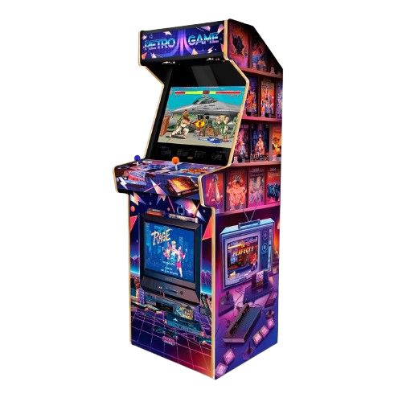

# ARCADE (v0.1)



### Development
By *Evans Ramin, Marin Jeunot & Sacha Lemée*.
```
evans.ramin@epitech.eu
```
```
marin.jeunot@epitech.eu
```
```
sacha.lemee@epitech.eu
```

### Contribution
Shared general architecture with *Nicolas Gonzales, Daniel Lozovan & Thibault Maillet*.
```
nicolas.gonzales@epitech.eu
```
```
daniel.lozovan@epitech.eu
```
```
thibault.maillet@epitech.eu
```

### Documentation
- **[Technical Documentation](doc/arcade_documentation_implementation_lib.md)** (md file)
- **[Architecure Documentation](doc/arcade_uml_file.excalidraw)** (excalidraw file)
- dlopen/dlclose/dlsym: https://tldp.org/HOWTO/html_single/C%2B%2B-dlopen/?utm_source=chatgpt.com#externC

## License

This project is licensed under the **Creative Commons Attribution-ShareAlike 4.0 International License** (CC BY-SA 4.0 DEED).


